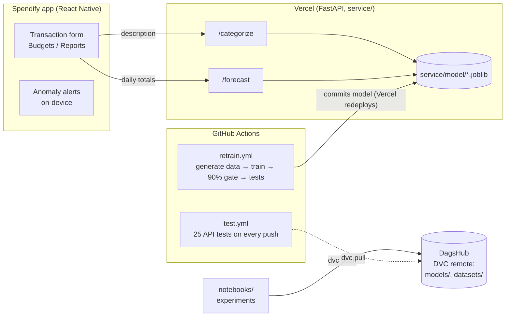

# Machine Learning for Spendify

The ML side of **Spendify**, my budget tracker app (React Native + TypeScript). Models are trained in notebooks, served by a FastAPI service on Vercel, and retrained and redeployed by GitHub Actions.

**Live API:** https://machine-learning-rose.vercel.app/health

| Feature in the app | How it works | Result |
|---|---|---|
| Category suggestion as you type (`JOLLIBEE*4821` → Food & Drinks) | TF-IDF (character n-grams) + logistic regression, `POST /categorize` | 97.1% test accuracy, 0.14 MB, 0.7 ms per description |
| Spending forecast (end of month, next month) | Gradient boosting (HistGB) on rolling averages and calendar features, `POST /forecast` | Ships only where it beat the baselines on a time-based test split |
| "You spent 3× your normal" alerts | Ratio rule vs robust z-score vs Isolation Forest | Runs on the phone, no data leaves the device |
| Week types on the Reports screen | K-means + PCA | 5 clusters, chosen by elbow + silhouette |

## Architecture



## MLOps

- **Versioning:** code in Git; models and datasets in [DVC](https://dvc.org) with a DagsHub remote (`models.dvc`, `datasets.dvc`). Rolling back a model is `git checkout <commit> models.dvc && dvc checkout`.
- **CI:** [`test.yml`](.github/workflows/test.yml) runs the API tests on every push and checks that DVC data can be pulled.
- **Retrain + redeploy:** [`retrain.yml`](.github/workflows/retrain.yml) rebuilds the training data (the generator is seeded, so it matches my local file byte for byte), trains with [`scripts/train_categorizer.py`](scripts/train_categorizer.py), refuses to save below 90% accuracy, runs the tests against the new model, and commits it. Vercel redeploys on that push.
- **Monitoring:** [`10-drift-monitoring`](notebooks/10-drift-monitoring.ipynb) tracks category mix (PSI), amounts (KS test) and model confidence month by month. Main finding: spending patterns are stable, but new merchants drop the model to 23% accuracy. That is the drift to watch.

## Notebooks

| # | Notebook | What it covers |
|---|---|---|
| 01 | [explore-spending](notebooks/01-explore-spending.ipynb) | pandas, matplotlib: top categories, monthly totals |
| 02 | [categorizer](notebooks/02-categorizer.ipynb) | TF-IDF, logistic regression vs trees vs random forest, cross-validation |
| 03 | [deployment](notebooks/03-deployment.ipynb) | Saving the pipeline, FastAPI, Docker |
| 04 | [anomalies](notebooks/04-anomalies.ipynb) | Ratio rule vs robust z-score vs Isolation Forest |
| 05 | [forecasting](notebooks/05-forecasting.ipynb) | Feature engineering, HistGB / LightGBM vs baselines, time-based splits |
| 06 | [week-types](notebooks/06-week-types.ipynb) | K-means, PCA |
| 07 | [nn-from-scratch](notebooks/07-nn-from-scratch.ipynb) | A neural network in NumPy, backprop by hand, gradient check |
| 08 | [pytorch](notebooks/08-pytorch.ipynb) | Autograd, `nn.Module`, optimizers, regularization |
| 09 | [transformer-vs-sklearn](notebooks/09-transformer-vs-sklearn.ipynb) | Fine-tuned DistilBERT vs MiniLM vs TF-IDF |
| 10 | [drift-monitoring](notebooks/10-drift-monitoring.ipynb) | PSI, KS test, confidence drift |
| 11 | [sql](notebooks/11-sql.ipynb) | SQLite: CTEs, window functions, joins |

## Blog

- [I tested a transformer against my 0.14 MB model. The small one stayed.](blog/sklearn-vs-transformer.md) DistilBERT matched the small model on known merchants (97.5% vs 97.1%) but was 1,900× larger and 44× slower, and did worse on unseen merchants (25.6% vs 63.0%).

## Run it locally

```bash
python -m venv .venv && .venv/Scripts/activate      # macOS/Linux: source .venv/bin/activate
cd service
pip install -r requirements.txt uvicorn pytest httpx # API only; ../requirements.txt has the notebook stack
python -m pytest tests -q                            # 25 tests
uvicorn app:app --reload                             # http://localhost:8000/docs
```

Training data is fake but realistic (`python scripts/generate_fake_data.py`); my real financial data never leaves my machine.
