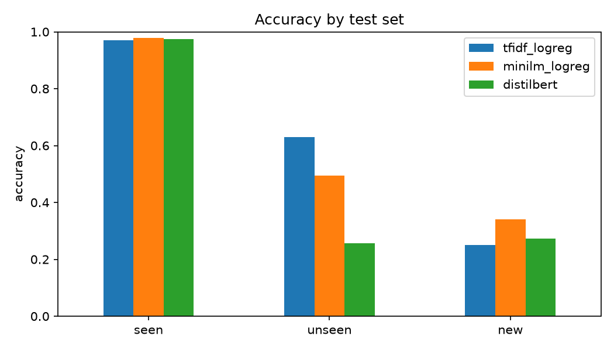
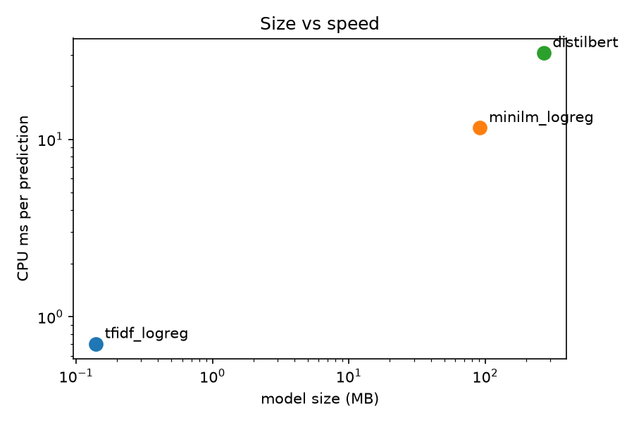

# I tested a transformer against my 0.14 MB model. The small one stayed.

## The question

Spendify is a budget app I'm building. When you type a transaction description like `JOLLIBEE*4821`, it suggests a category, Food & Drinks in that case, so logging spending takes one tap. The suggestion comes from a small scikit-learn model: character n-gram TF-IDF features and logistic regression, served from a free Vercel function.

That model scored 96% on its test set. So why look further? Because transformers are the default answer to "text classification" in 2026, and I wanted to know whether that default holds for *my* problem. For this app, "better" has to mean more than accuracy: the suggestion chip must feel instant, the server is free, and the model will mostly meet merchants it has never seen.

## The setup

I compared three models, all trained on exactly the same rows:

- **TF-IDF + logistic regression:** my existing model. It learns which letter combinations go with which category.
- **MiniLM + logistic regression:** a pretrained sentence model (`all-MiniLM-L6-v2`) turns each description into 384 numbers, without any fine-tuning, and logistic regression classifies those.
- **DistilBERT, fine-tuned:** a pretrained transformer whose weights are all trained further on my data (3 epochs, learning rate 5e-5, on an RTX 3060).

One random train/test split isn't enough here. The data has 72 merchants written many ways (`JOLLIBEE*4821`, `jollibee makati`), so a random split puts the same merchant on both sides, and every model just recognises names it has already seen. So I used three test sets:

1. **Seen merchants:** the usual random 80/20 split (1,102 training rows, 276 test rows).
2. **Unseen merchants:** 15 merchants held out completely, every spelling of them (1,081 training rows, 297 test rows). A check confirms no merchant appears on both sides.
3. **New Philippine merchants:** 44 real merchants that never appear in the data, like Popeyes, Andok's, Caltex and Zalora. These are scored with the models from the unseen experiment.

To keep it fair, every model was timed the same way: on the CPU, one thread, one description per call, the median of 200 calls after a warm-up. That's what a small server actually does.

## Results

| Model | Seen | Unseen | New PH merchants | Size | CPU latency |
|---|---|---|---|---|---|
| TF-IDF + LogReg | 97.1% | **63.0%** | 25.0% | **0.14 MB** | **0.70 ms** |
| MiniLM + LogReg | **97.8%** | 49.5% | **34.1%** | 91.61 MB | 11.6 ms |
| DistilBERT (fine-tuned) | 97.5% | 25.6% | 27.3% | 268.57 MB | 30.7 ms |

On merchants the models had seen, all three tie at about 97%. Macro F1, which weighs rare categories as much as common ones, separates them a little: MiniLM 0.897, DistilBERT 0.796, TF-IDF 0.792. On merchants they had never seen, the order flips: the smallest model is best, and the fine-tuned transformer is worst.

## What surprised me

I expected DistilBERT to win on unseen merchants. Its lower layers learned from Wikipedia and books, so in theory it already knows that "pharmacy" or "pizza" means something, and fine-tuning only has to connect that knowledge to my 11 categories. Instead it dropped to 25.6%, less than half of TF-IDF's 63.0%.

My best explanation: with only 72 merchants to learn from, fine-tuning taught DistilBERT the merchant names themselves rather than what the words mean. It memorised a lookup table. Its mistakes on the new merchants point the same way: `BENCH*7710` (a clothing shop) became Salary, and `Converge FiberX` (internet) became Groceries. Those answers aren't close to any reading of the name.

The simple model's mistakes were different: it matched letters. `Yellow Cab Pizza` became Transportation, because it saw "cab" and ignored "pizza". Many other mistakes were reasonable. Goldilocks, a bakery, went to Coffee & Snacks instead of Food & Drinks, a line people blur too. Some names, like Caltex or Payoneer, carry no category information unless you already know the brand.

MiniLM, which reads but is never trained, did best on brand-new merchants (34.1%), and its mistakes made the most sense. But no model got a single income row right, even `ACME CORP SALARY` with "salary" right there, because income has very few training examples.

This experiment has limits. The data is generated, not real spending; there are only 72 merchants; and I used one fixed set of fine-tuning settings, with no tuning. A transformer trained on thousands of real merchants could well do better. What it shows is that on a dataset this size, the bigger model isn't automatically the better one.

## The production view

Even if accuracy had been equal, the costs aren't:

- **Size:** TF-IDF is 0.14 MB. DistilBERT is 268.57 MB, about 1,900 times larger, and MiniLM is 91.61 MB. Both also need PyTorch, which adds hundreds of MB more and likely won't fit a free serverless function. If it did, every cold start would load all of it.
- **Speed:** on one CPU thread, TF-IDF takes 0.70 ms per description, MiniLM 11.6 ms and DistilBERT 30.7 ms, about 44 times slower. A chip that appears while you type needs the small model's speed.
- **Retraining:** DistilBERT took 6.8 s to train on a GPU, against 0.1 s for TF-IDF on a CPU. The small model can retrain after every correction on a free server.

So Spendify keeps TF-IDF + logistic regression. For one user, a free server and an instant suggestion, it wins on every practical measure, and the transformer didn't buy accuracy on this data. I'd revisit that with many real users, a GPU server, and evidence that a transformer handles new merchants better. Whatever model ships, a new merchant's category stays a suggestion that learns from the user's correction.

## What I'd try next

- **Combine the two strengths:** use TF-IDF for merchants the user has seen before, and MiniLM's embeddings only when TF-IDF isn't confident. That means one fast path and one smarter fallback.
- **Fine-tune on more merchants, not more rows:** DistilBERT likely failed because it saw 72 names. A few thousand real merchant names should show whether that's the cause.
- **Fix income first:** add more income examples. No model can predict a category it has barely seen, and that's a data problem, not a model problem.
- **Learn from corrections:** every time a user changes a suggestion, that's a new labelled example for exactly the merchants that matter to them.
